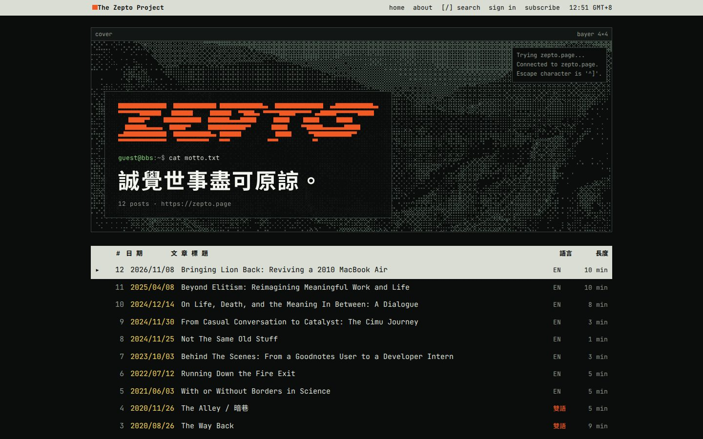
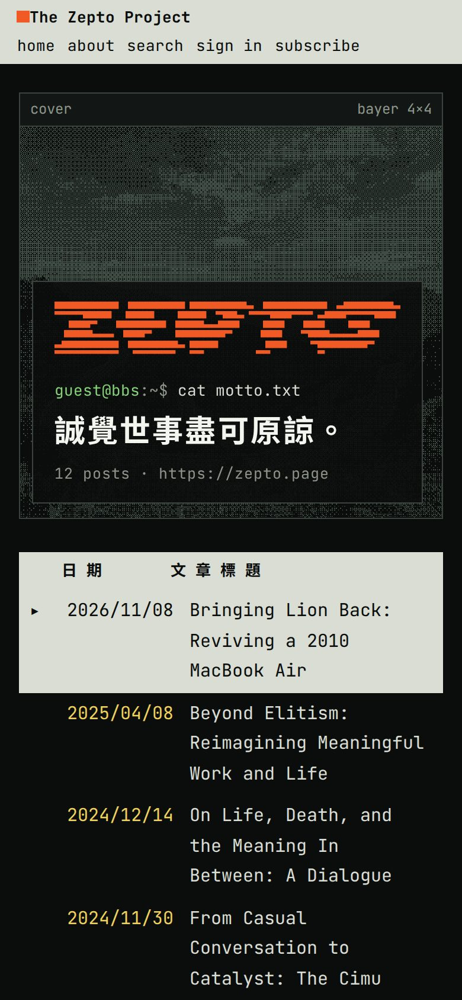
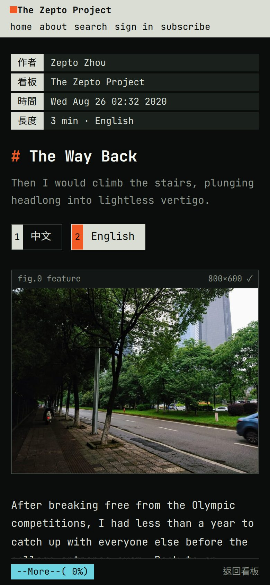
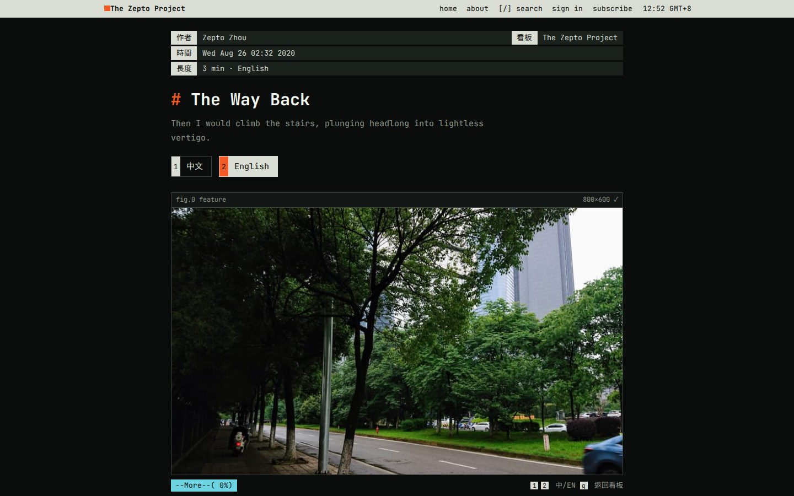
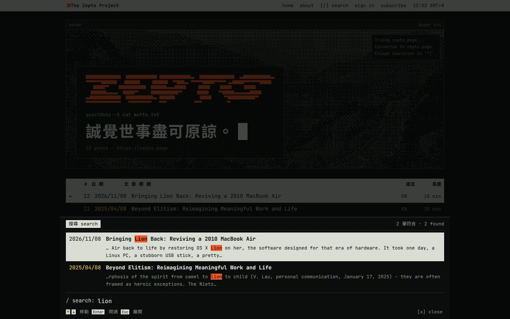
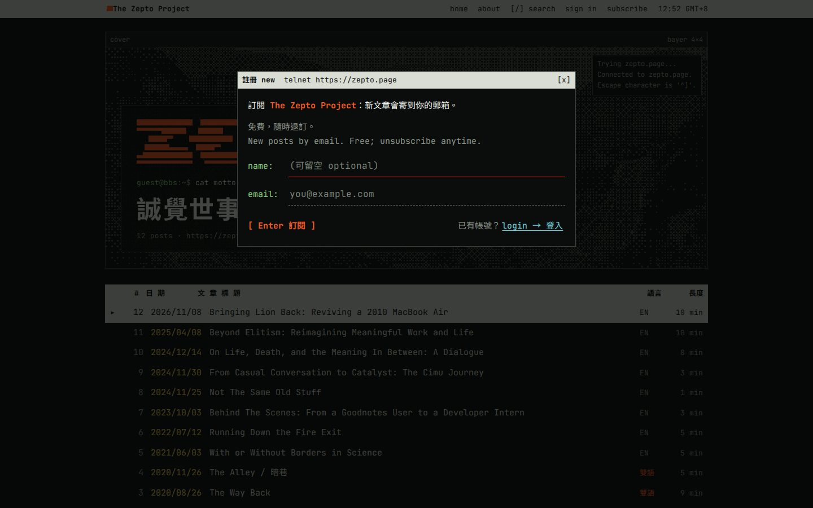

# Terminal BBS 終端

A Ghost theme in the style of a telnet-era Chinese BBS. The home page is a board: numbered posts you move through with `j`/`k` and open with Enter, under a cover photo dithered in phosphor and your logo redrawn in block characters. Posts open with the 作者 / 看板 / 時間 header, headings keep their Markdown `##`, tables are drawn as terminal grids, and a `--More--(42%)` pager tracks how far you've read. Images arrive as a dithered scan and develop into the real picture as they scroll into view.



<p>


</p>



## Features

- A keyboard-first board with one cursor shared by mouse and keys
- Logo redrawn in half-block characters; cover image dithered with a 4×4 Bayer matrix
- Images that develop from a dithered scan as they scroll into view (can be turned off)
- A sticky `--More--` pager, BBS signature lines and `q` to go back to the board
- Grey, amber or green phosphor
- Search that opens as a command line at the bottom of the screen; sign-in and subscribe as a telnet login window
- Bilingual 中文 / English posts with per-language reading time
- A phone layout down to 320px wide, with keyboard hints hidden on touch screens

## Install

1. Download `terminal-bbs-1.0.0.zip` from the [latest release](https://github.com/XGZepto/terminal-bbs/releases/latest).
2. In Ghost Admin, go to **Settings → Design & branding → Change theme → Upload theme** and choose the zip.
3. Activate it.

Requires Ghost 6.0 or later. Fonts load from Google Fonts.

## Writing for this theme

**Bilingual posts.** Write the Chinese version, insert a divider (the `---` card), then write the English version, and add the internal tag `#bilingual`. Readers get a `[1] 中文` / `[2] English` switch and their choice is remembered; reading time is recalculated for the language they read. Without JavaScript, and in email and RSS, the post reads in full exactly as written. A first paragraph reading "(English version follows)" is hidden automatically.

**Simplified Chinese.** Tag a post `#zh-hans` to set it in Simplified character forms. Other Chinese text is detected automatically and set in Traditional forms.

**Chinese emphasis.** Italic Chinese is set in Chiron Hei HK italic.

## Keys

| Key | Where | Does |
| --- | --- | --- |
| `j` / `k` | Board | Move the cursor |
| Enter | Board | Open the post |
| `q` / Esc | Post | Back to the board |
| `1` / `2` | Bilingual post | 中文 / English |
| `/` | Anywhere | Search |

**Banner.** With a site logo, the home banner redraws it in block characters (or set the banner to the site title). Without a cover image the banner sits in a plain window.

## Search, sign-in and subscribe

- **Search** reads your posts through the Content API (with the RSS feed as a fallback) and searches titles, tags, excerpts and full text. Chinese is matched anywhere in the text; English matches at the start of words. Press `/` to open it.
- **Sign-in and subscribe** send Ghost's usual magic link. Ghost's own links, such as `#/portal/signup` in your navigation or the sign-in button in the comments box, open the theme's version too, and the confirmation after a magic link is shown in the theme's style.
- **Your membership settings decide what readers see.** On a site with free signup, Subscribe opens the theme's form. On sites with paid tiers, or where signup requires agreeing to terms, Subscribe opens Ghost's Portal so readers can choose a plan or accept the terms. On invite-only sites only Sign in is shown. The member account page uses Portal, and Portal's floating button is hidden.

<p> </p>

## Theme settings

In Ghost Admin → Settings → Design & branding → Theme:

| Setting | What it does |
| --- | --- |
| Phosphor | Text colour on screen: grey, amber or green |
| Banner | Your logo redrawn in block characters, or the site title |
| Boot sequence | A short connection log on the first visit of a session |
| Develop images | Images arrive as a dithered scan and develop as they scroll into view |
| Default language | Which half a `#bilingual` post opens on: the reader's browser language, 中文 or English |

Custom fonts chosen in Ghost Admin (Settings → Design & branding → Brand) replace the theme's heading and body faces.

## Development

```bash
pnpm install
pnpm test      # gscan, Ghost's theme validator
pnpm zip       # dist/terminal-bbs-<version>.zip, ready to upload
```

To work against a local Ghost, link this folder into its themes directory and activate it:

```bash
ln -s "$PWD" /path/to/ghost/content/themes/terminal-bbs
```

`assets/css/screen.css` and the scripts in `assets/js/` are served as written. Search and the sign-in dialog run from `search.js` and `members.js`; how they look is set in `main.js`, the partials and the CSS.

## Credits

Typefaces from Google Fonts, all under the SIL Open Font License: JetBrains Mono, Noto Sans TC, Noto Sans SC and Chiron Hei HK. Built for [Ghost](https://ghost.org).

## License

[MIT](LICENSE)
